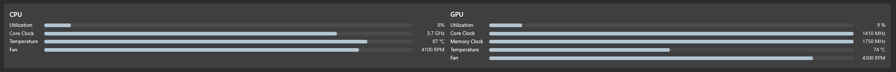
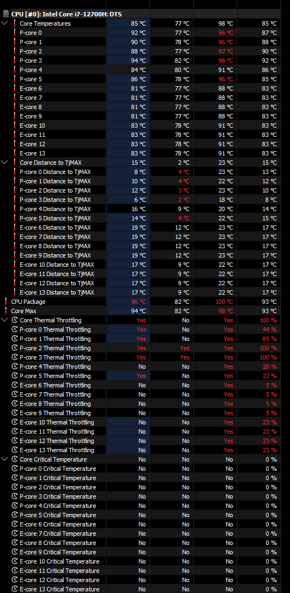
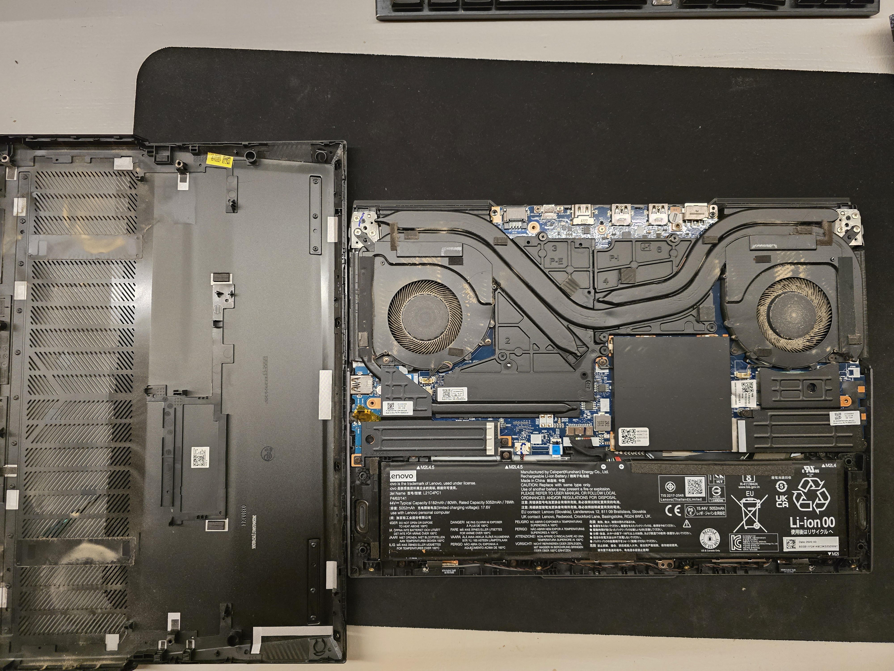
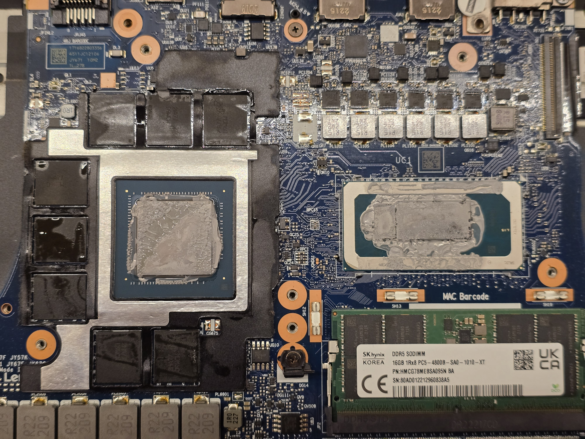
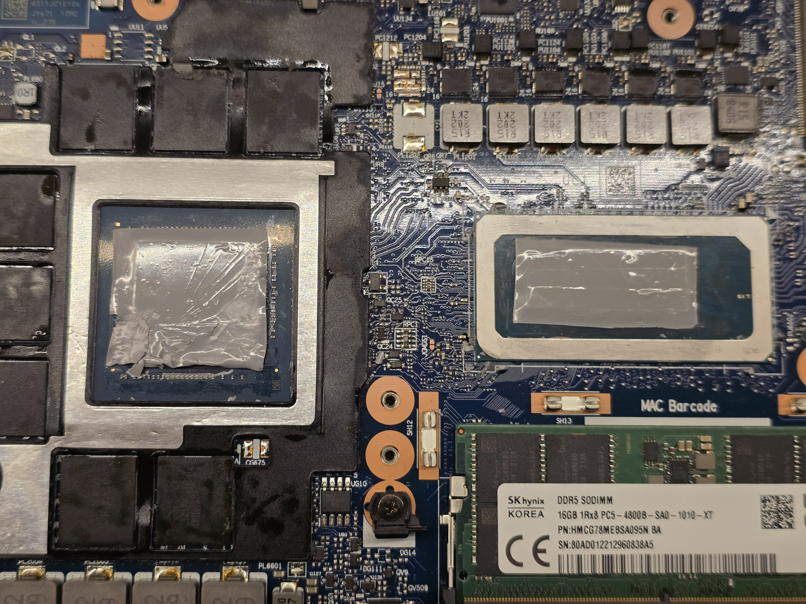
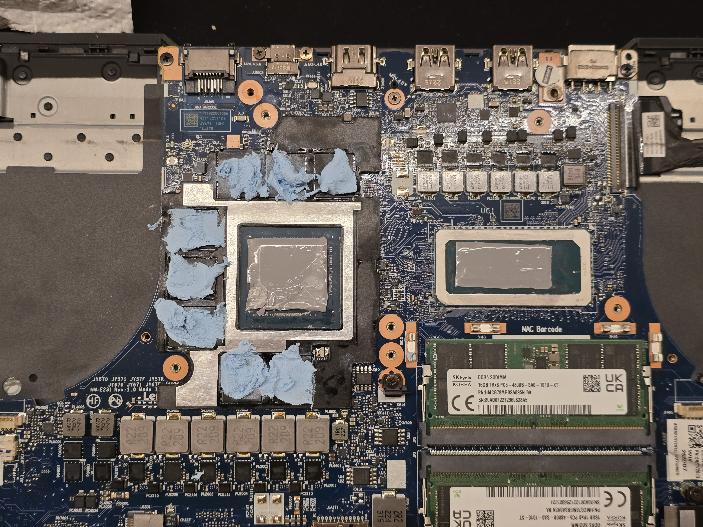
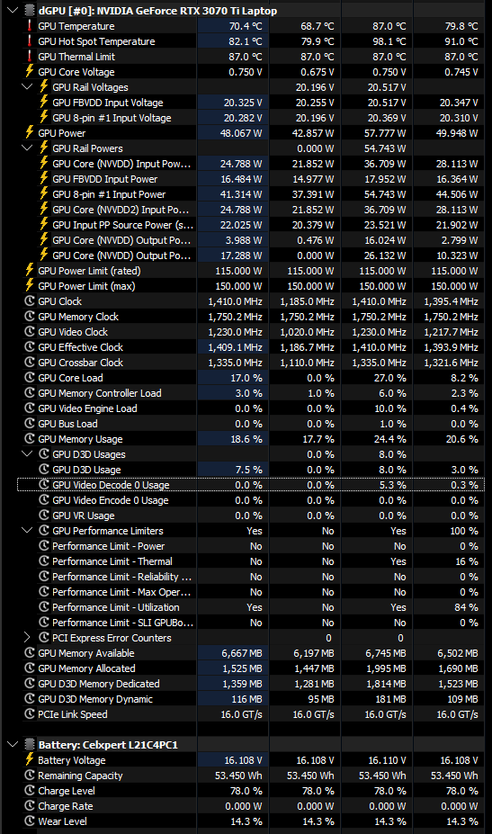
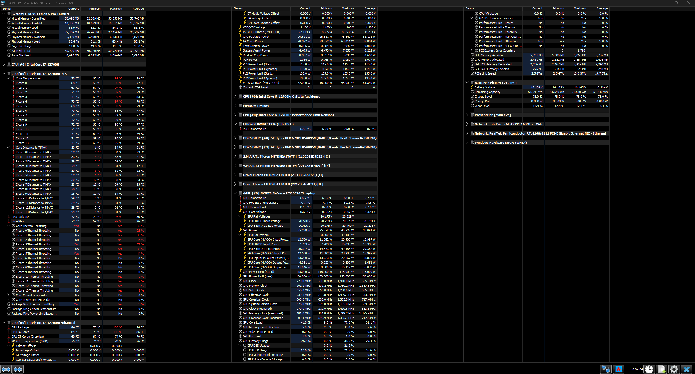
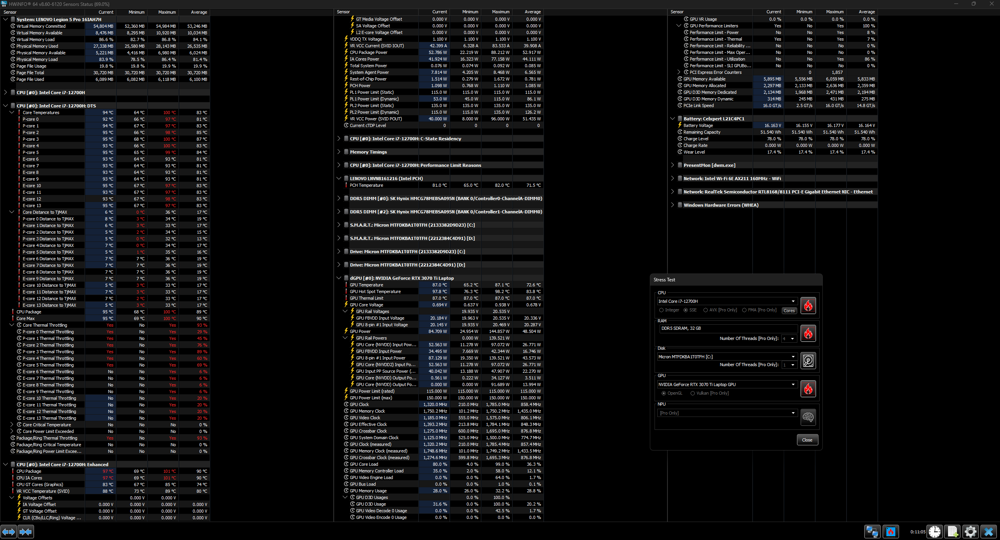

My Lenovo Legion 5 Pro (16IAH7H, i7-12700H, RTX 3070 Ti) had always run hot when working with Docker, WSL2, and Visual Studio, but by early June it started screaming even at idle. The fans were spinning at 4,100–4,300 RPM while the machine was doing virtually nothing.

This is the log of two HWiNFO64 sessions — one from the broken days in June, one from a stress test five months after the repaste on November 16 — plus the teardown that happened in between. It is not a victory post. It is a post about finding out which layer of the problem you actually fixed, and which one you only thought you fixed.

## The Symptoms in June

I fired up HWiNFO64. The numbers were bad everywhere I looked:

| Situation                 | CPU                | GPU                                            | Chipset | RAM    |
| ------------------------- | ------------------ | ---------------------------------------------- | ------- | ------ |
| Load                      | 100°C              | 87°C @ 141.2W, Hot Spot 98.3°C, 74% throttling | 82°C    | —      |
| Idle (8–15% load, 23–28W) | 91–97°C, throttled | —                                              | —       | 71.2°C |
| External 144Hz monitor    | —                  | 85.3°C @ 52.3W                                 | —       | 71.2°C |

The idle numbers are the ones that made this a repair job rather than a "gaming laptops get warm" job. At 8–15% load, pulling 23–28W, a CPU has no business sitting at 91–97°C and thermal throttling. The fans at 4,100–4,300 RPM confirmed the machine was trying to solve something it could not solve.

_Sensors at idle on AC power: the CPU was pinned at 87°C while doing almost nothing, and both fan curves were maxed out._

## Pre-Disassembly Software Check

Because the legacy `wmic` command is deprecated in Windows 11, I inspected the system using PowerShell and `powercfg`. It turned out that the "ChrisTitus - Ultimate Power Plan" had locked the Minimum Processor State (`PROCTHROTTLEMIN`) to 100% (`0x64`) on AC power. As a result, the CPU never downclocked, running constantly at 3.7–4.4 GHz.

On top of that, 288 background processes and over 6,700 threads were running: Docker, WSL2, Visual Studio, six instances of NVIDIA Broadcast, an outdated Driver Booster, an unresponsive `audiodg.exe`, and a USB "Device Failed Enumeration" error.

Using CMD, I dropped the minimum state down to 5% (`0x00000005`). Fan speeds dropped slightly, to about 3,700 RPM, but the CPU still spiked to 91°C. Software tweaks could not fix dried-out thermal paste.

_HWiNFO64 per-core view before any hardware work: all six P-cores pinned near 96°C with throttling already active._

## June 9 Teardown and Material Selection

Standard thermal paste, like Arctic MX-4, was not an option here. The Legion uses a direct-die heatsink mount, where high mounting pressure and thermal cycling cause conventional paste to pump out within weeks. Buying traditional thermal pads was also risky: the components require varying thicknesses from 0.5 to 1.5 mm, and a pad that is even slightly too thick would lift the heatsink off the bare dies.

So for the June 9 repaste, I picked up Thermal Grizzly PhaseSheet PTM (50x40 mm) for the dies, Putty Advance thermal putty for the memory chips, and 96% alcohol from the pharmacy.

It was my first time tearing down this specific laptop, and prying open the bottom panel was the hardest part. The seam between the panel and chassis was practically invisible. I barely wedged the corner of a plastic card in before unclipping the perimeter with a series of loud snaps. Once inside, I disconnected the battery and held the power button for 15 seconds to discharge residual power. At first I thought the heatsink screws were not numbered, but then I spotted the embossed "3, 4, and 6" on the black metal. I loosened them in reverse order to prevent uneven pressure from cracking the bare silicon.

_Teardown view: bottom cover off, dual fans, heatsink and battery visible._

Lifting the heatsink revealed completely dried-out paste on the dies, while the eight VRAM chips around the GPU were soaked. I panicked at first, thinking something had leaked, but it turned out to be silicone oil bleeding from the deteriorating stock thermal pads.

_The two bare dies after the heatsink came off — completely dried-out paste, ready for cleaning._

I cleaned both dies to a mirror shine using cotton pads and Q-tips lightly moistened with 96% alcohol. I left the minor residue in the crevices around the die untouched: delicate surface-mount capacitors sit there, and scraping them with hard tools could kill the GPU. Since 96% ethanol contains 4% water, I let everything air-dry for 10 minutes.

Before cutting the PhaseSheet PTM, I put it in the fridge (not the freezer) for 10 minutes to prevent the pliable sheet from stretching. I applied it directly to the dies and carefully peeled off the top protective film. On all eight VRAM chips, I placed pea-sized balls of Putty Advance, while leaving the pink stock VRM pads untouched since they were still intact.

_The dies with PhaseSheet PTM applied, cut to fit and film peeled off._

_VRAM chips got pea-sized blobs of blue thermal putty; the pink stock VRM pads were left intact._

I remounted the heatsink and torqued the screws in sequence, 1 through 6. The only thing I skipped out of laziness was removing the cooling fans; I just wiped the fan blades from the outside.

## Results in June

On first boot, temperatures immediately spiked to 90–100°C, and my heart skipped a beat. Then I remembered that cold PhaseSheet PTM needs to hit 45–50°C to melt and fill microscopic gaps — and Windows had instantly launched Docker and WSL2.

Within minutes, the average idle clock dropped to 1.68 GHz, the CPU stabilized at 81–83°C under a 55–58% load, and thermal throttling ceased entirely. On the external 144Hz monitor, GPU temps dropped from 85.3°C to 70.4°C at 48W, with a Hot Spot at 82.1°C — an 11.7°C delta. The RAM cooled down from 71.2°C to 65.0°C. You could feel warm air being pushed out 2–3 cm away from the exhaust vents.

_June result: GPU at 70.4°C on the external 144Hz monitor at 48W — down from 85.3°C._

## 5 Months Later: November 16 Stress Test

Five months later, I launched HWiNFO64 again to check idle behavior, followed by a combined CPU + GPU stress test.

At idle, GPU power consumption was actually better than in June: the memory clock downclocked to 101.2 MHz, power draw dropped to 25.3W, and the temp sat at 66.2°C, with a Hot Spot of 77.4°C — an 11.2°C delta. However, my "idle" system had 88.4% of RAM (27.1 GB) swallowed by background processes, and the CPU averaged 51.1W and was still spiking up to 99–100°C.

_November idle: GPU down to 66.2°C, but the CPU still spiking to 99–100°C because 27.1 GB of RAM was swallowed by background processes._

The full combined stress test, all 11 minutes and 5 seconds of it, revealed two clear facts.

**Die contact: the PTM is fine.** All six CPU P-cores heated up evenly — 92, 94, 95, 95, 93, 95°C, a tight 3°C delta — and the delta between the GPU core (87.0°C) and Hot Spot (97.8°C) was just 10.8°C. Five months in, the PhaseSheet PTM had neither pumped out nor degraded.

**Thermal dissipation ceiling: the cooler cannot keep up.** Under full load, the cooling system could only exhaust about 138W total — 52.8W CPU + 84.7W GPU. The GPU dropped from its rated 144.8W down to 84.7W, hitting its 87.0°C thermal limit and throttling by 7%. The CPU sat at 95–97°C with 93% thermal throttling, PL1 dropping to 53W. The PCH chipset hovered at 81–82°C.

_Full load stress test: CPU at 95°C / 100% throttling, GPU clamped at 84.7W and its 87°C limit._

## Where I Went Wrong

When core-to-core and core-to-hotspot deltas remain this low — 3°C on the CPU and 10.8°C on the GPU — but the entire system suffocates at just 138W, the thermal interface material is no longer the bottleneck. The interface did its job. The heat simply has nowhere to go.

Because I skipped cleaning the fans back in June, five months of fresh dust had accumulated on top of the old dust trapped between the fan impellers and heatsink fins, choking the airflow.

| Measurement                     | June (after repaste)  | November 16 (5 months later)      |
| ------------------------------- | --------------------- | --------------------------------- |
| GPU temp @ external 144Hz       | 70.4°C @ 48W          | 66.2°C (idle, Hot Spot 77.4°C)    |
| CPU idle load                   | 1.68 GHz, 55–58% load | 51.1W average, spikes to 99–100°C |
| CPU per-core delta under load   | —                     | 3°C (92–95°C)                     |
| GPU core to Hot Spot delta      | 11.7°C                | 10.8°C                            |
| Total exhaustible package power | —                     | ~138W (CPU throttled at 93%)      |

The lesson is that a repaste fixes the interface, not the system. I spent June proving that PTM on this direct-die mount is stable, and November proving that the cooler was dust-choked the whole time. Both conclusions were visible in the sensors; only one of them was visible in June.

The heatsink and PTM do not need to be touched. I will simply remove the bottom panel, pull out just the fans to clear the fins, and make sure to prop up the rear of the laptop by 2 cm during heavy workloads. If the deltas stay flat and the wattage ceiling moves, the thermal design was fine all along and the dust was the whole story.
